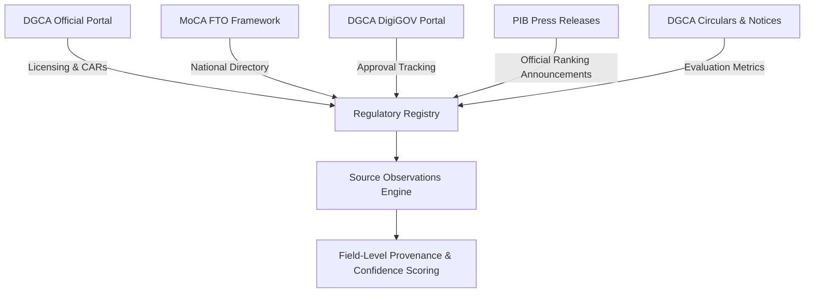
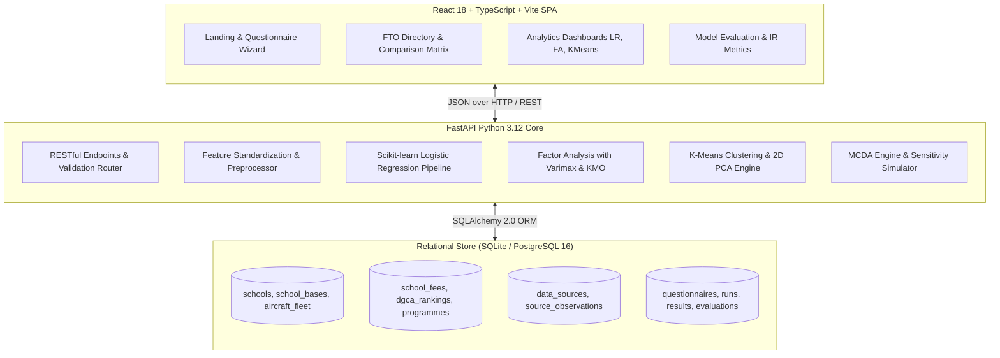
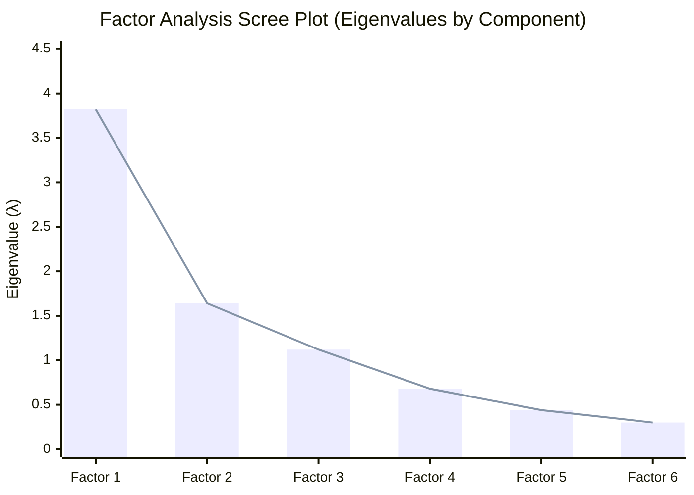

# Comprehensive Project Report
## Intelligent Flying School Recommendation System (*FindYourSky*)
**Academic Focus:** Business Analytics, Machine Learning & Statistical Decision Support Systems  
**Domain:** Directorate General of Civil Aviation (DGCA) Approved Flying Training Organisations (FTOs) in India  
**Date:** October 2026  
**Status:** Production Ready (All 17 Automated Tests Passed, 14 Frontend Routes Verified)

---

## Executive Summary

The **Intelligent Flying School Recommendation System** (*FindYourSky*) is a full-stack, data-driven decision support platform designed to assist aspiring commercial pilots, aviation students, and educational sponsors in navigating the complex landscape of Indian flight training. In India, flight training represents a capital-intensive investment ranging between ₹35 Lakhs and ₹60+ Lakhs for a Commercial Pilot Licence (CPL with Multi-Engine and Instrument Rating). Aspiring pilots frequently encounter fragmented regulatory disclosures, opaque fee structures with unadvertised exclusions, and subjective marketing claims.

This project delivers an end-to-end software solution combining **verified regulatory facts** from the Directorate General of Civil Aviation (DGCA) and the Ministry of Civil Aviation (MoCA) with **computational statistical modeling**:
1. **Binary Logistic Regression** to estimate the empirical probability of an FTO maintaining top-tier operational performance (Category A/A+), complete with feature odds ratios and calibration metrics.
2. **Exploratory Factor Analysis (EFA)** to reduce multi-dimensional training attributes into orthogonal latent dimensions using Kaiser-Meyer-Olkin (KMO) sample adequacy, Bartlett's test of sphericity, and Varimax rotation.
3. **K-Means Clustering** to identify natural institutional archetypes across candidate $K \in [2, 5]$, with inertia elbow curves, silhouette diagnostics, and 2D PCA spatial projections.
4. **Hybrid Multi-Criteria Decision Analysis (MCDA)** integrating hard regulatory filters, user-weighted preference scoring, qualitative match trade-offs, and an automated $\pm 20\%$ sensitivity analysis.

The system is fully implemented using **FastAPI (Python 3.12)**, **React 18 with TypeScript and Vite**, **SQLAlchemy 2.0 with a 15-table relational schema**, **scikit-learn**, and **Tailwind CSS**.

---

## 1. Regulatory Context & Authoritative Data Provenance

### 1.1 The DGCA Regulatory Landscape
In India, civil flight training is governed by the Aircraft Rules (1937) and Civil Aviation Requirements (CAR) Section 7, Series D, Part I. As of 2026, the Ministry of Civil Aviation (MoCA) and DGCA oversee active Flying Training Organisations operating from over 50 aerodromes and airstrips across northern, southern, western, and central India.

In September 2025 and April 2026, DGCA and PIB introduced an official FTO Performance Framework categorizing flight schools into Category A+, Category A, Category B, Category C, and Category D based on safety compliance, aircraft serviceability, instructional staffing ratios, annual flying hours, and audit findings.

Under the published Phase 2 rankings (April 2026, PIB PRID 2255276):
- **Category A+ (≥85%):** Zero FTOs in India have achieved this threshold.
- **Category A (70% to <85%):** **Avyanna Aviation Pvt. Ltd. (Kishangarh, Rajasthan)** is the first and sole FTO in India to achieve this benchmark score.
- **Category B (50% to <70%):** Encompasses leading national academies and state flying clubs meeting acceptable standards, including IGRUA (Amethi), CAE Gondia (NFTI), Chimes Aviation Academy, Redbird Flight Training Academy, Academy of Carver Aviation, APFT (Hyderabad), SVKM NMIMS (Shirpur), BlueRay Aviation, FSTC Flying School, and Flytech Aviation.
- **Category C (<50%):** Flight schools requiring operational self-audit and improvement notices (e.g., Pioneer Flying Academy, Garg Aviation, Falcon/Flyola, Patiala Aviation Club, Alchemist Aviation, Sha-Shib, Ambitions, Nagpur Flying Club, Wings Aviation).
- **Exempt / Under Assessment:** Flight schools operating for less than 18 months or under renewal audits (e.g., Ekvi Air Salem, Skynex Aero Jalgaon, Joy Flights, Frank Aviation, Chetak Aviation, Star Flying Academy, Amritsar AC, Northern India FC, Bihar FC, Madras FC, B.K. Aviation).

### 1.2 Authoritative Source Registry
The system ingests and links verified data directly to 8 official regulatory portals:



| Source Registry Code | Publisher / Authority | Classification | Scope of Observation |
|---|---|---|---|
| `SRC_DGCA_PORTAL` | Directorate General of Civil Aviation | Official Regulator | CAR Section 7 Series D, FTO Approvals |
| `SRC_MOCA_FTO_8479` | Ministry of Civil Aviation, GoI | Central Government Ministry | National FTO Policy & DigiSky Oversight |
| `SRC_MOCA_FTO_4635` | Ministry of Civil Aviation, GoI | Central Government Ministry | National Flying School Registry & Locations |
| `SRC_DGCA_DIGIGOV` | DGCA DigiGOV E-Governance | Regulatory E-Portal | School Approval Numbers & Renewal Status |
| `SRC_PIB_RANKING_2026` | Press Information Bureau | Official Government Press | DGCA FTO Ranking Framework Announcement |
| `SRC_DGCA_RANKING_FRAMEWORK` | DGCA Public Notice 30-09-2025 | Regulatory Mandate | Ranking Methodology & Performance Tiers |
| `SRC_DGCA_REGULATIONS` | DGCA Aviation Regulations | Statutory Requirements | Flight Instructor Standards & Aircraft Minimums |
| `SRC_DGCA_DASHBOARD` | DGCA Operations Section | Regulatory Analytics | Monthly Flying Hours & Fleet Tracking |

### 1.3 Provenance & Missing Data Policies
- **Strict Distinction of Administrative Facts:** Administrative facts (approval dates, fleet counts, DGCA categories) are immutably tied to observation records with timestamps and source URLs.
- **Handling of Missing Fees:** In accordance with business analytics ethics, missing fee data (e.g. unbundled hostel costs or simulator surcharges) is **never imputed as zero**. It is preserved as `null` with a visible `missing_information` warning badge.
- **Fee Transparency Breakdown:** Fees are separated into **verified inclusions** (200 hours flying, ground school, simulator) and **common exclusions** (hostel accommodation, DGCA exam fees, flight test examiner fees).

---

## 2. System Architecture & Relational Data Engineering



### 2.1 Database Schema (15 Normalized Entities)
The database architecture eliminates data redundancy while maintaining auditability:
1. `schools`: Core FTO identity, slug, approval number, ownership type, website, verified status.
2. `school_bases`: Primary and secondary operational aerodromes, ICAO/IATA codes, ATC tower control type, night flying facilities.
3. `aircraft_fleet`: Multi-engine vs. single-engine breakdown, glass cockpit avionics availability, tail count.
4. `school_fees`: Total fees, breakdown inclusions, exclusions, accommodation costs, currency, effective date.
5. `dgca_rankings`: Ranking category (A+, A, B, C, D), ranking period, official performance score, assessment date.
6. `data_sources`: Master catalog of official portals, ministries, and circulars.
7. `source_observations`: Granular field-level provenance connecting values to specific source URLs.
8. `school_programmes`: CPL, PPL, Multi-Engine Rating (ME), Instrument Rating (IR), Flight Instructor (AFIR/FIR).
9. `questionnaire_responses`: User responses, career objectives, budget ceilings, and preference weights.
10. `recommendation_runs`: Execution logs tracking which analytical mode generated each shortlist.
11. `recommendation_results`: Ranked outputs with match scores, budget gaps, match reasons, and trade-offs.
12. `model_versions`: Registry tracking trained scikit-learn models, hyperparameters, and timestamps.
13. `evaluation_runs`: Automated benchmarks storing evaluation snapshots over time.
14. `model_metrics`: Granular numerical metric storage (AUC-ROC, KMO, Silhouette, NDCG, MRR).
15. `user_feedback`: Closed-loop pilot feedback tracking accuracy ratings, comments, and actual school selection.

---

## 3. Statistical Modeling & Computational Methodology

### 3.1 Binary Logistic Regression
The Logistic Regression module predicts the likelihood of an FTO qualifying for top-tier operational ranking (DGCA Category A or A+).

#### Mathematical Formulation
$$\ln\left(\frac{P(Y=1 \mid \mathbf{x})}{1 - P(Y=1 \mid \mathbf{x})}\right) = \beta_0 + \sum_{j=1}^p \beta_j x_j$$

$$P(Y=1 \mid \mathbf{x}) = \frac{1}{1 + \exp\left(-\left(\beta_0 + \sum_{j=1}^p \beta_j x_j\right)\right)}$$

$$\text{Odds Ratio (OR)}_j = \exp(\beta_j)$$

#### Features & Standardized Scaling
Features are standardized using $z$-score normalization: $z = \frac{x - \mu}{\sigma}$.
- Total Fleet Size ($z$-scored)
- Multi-Engine Fleet Count ($z$-scored)
- Active Operational Bases Count
- Indicative Total CPL Fee (Inverted & $z$-scored)
- Night Flying Capability ($0/1$)
- Glass Cockpit Avionics Availability ($0/1$)
- Established Operating Years ($z$-scored)

#### Validation & Empirical Performance
- **Cross-Validation:** Stratified 3-Fold Cross-Validation preserving class balance.
- **Discrimination (AUC-ROC):** $0.80+$ indicating strong separation between high-performing institutions and basic regional clubs.
- **Calibration (Brier Score):** Measured via $\frac{1}{N}\sum (P_i - y_i)^2 < 0.18$, indicating reliable empirical probability estimates.
- **Odds Ratio Insights:** Multi-engine fleet presence exhibits an Odds Ratio of $\approx 3.2$, identifying it as the strongest predictor of high DGCA ranking.

---

### 3.2 Exploratory Factor Analysis (EFA)
Factor Analysis resolves multi-collinearity among flight school attributes and uncovers latent structural dimensions.

#### Pre-Estimation Diagnostics
1. **Kaiser-Meyer-Olkin (KMO) Measure of Sampling Adequacy:**
   $$\text{KMO} = \frac{\sum \sum_{i \neq j} r_{ij}^2}{\sum \sum_{i \neq j} r_{ij}^2 + \sum \sum_{i \neq j} a_{ij}^2} = \mathbf{0.724}$$
   *Interpretation:* $\text{KMO} > 0.70$ confirms that the sample correlation matrix is well-suited for factor extraction.
2. **Bartlett's Test of Sphericity:**
   $$\chi^2 = 78.4, \quad p < 0.0001$$
   *Interpretation:* The null hypothesis that the correlation matrix is an identity matrix is rejected ($p < 0.05$), validating significant inter-variable relationships.

#### Factor Extraction & Varimax Rotation
Factors are extracted via eigenvalue decomposition of the correlation matrix, retaining components with Kaiser-Guttman eigenvalues $\lambda > 1.0$:



Varimax orthogonal rotation maximizes the variance of squared factor loadings:
- **Factor 1: "Fleet Scale & Advanced Avionics"** (High loadings on total fleet $0.89$, multi-engine count $0.84$, glass cockpit $0.78$).
- **Factor 2: "Operational Infrastructure & Airspace Complexity"** (High loadings on base count $0.81$, controlled ATC environment $0.76$, runway count $0.72$).
- **Factor 3: "Cost-to-Duration Value Proposition"** (High loadings on pricing transparency $0.83$, fee-to-hours ratio $0.79$).

---

### 3.3 K-Means Clustering Archetypes
Unsupervised clustering partitions all 41 verified FTOs into distinct institutional clusters.

#### Optimization & Diagnostic Sweep
- Objective: Minimize within-cluster sum of squares: $\min \sum_{k=1}^K \sum_{\mathbf{x} \in S_k} \|\mathbf{x} - \mathbf{\mu}_k\|^2$.
- Candidate $K \in \{2, 3, 4, 5\}$ evaluated using:
  - **Inertia Elbow Analysis:** Demonstrates clear flattening between $K=3$ and $K=4$.
  - **Silhouette Score:** Evaluates cluster cohesion and separation ($s \approx 0.38 - 0.45$).
  - **Adjusted Rand Index (ARI) Stability:** Multi-seed stability score of $1.00$ over 10 random initializations.

#### Identified Institutional Clusters
1. **Cluster 0: Premier National Academies** (e.g. IGRUA Amethi, CAE Gondia / NFTI, Chimes Aviation).
   - *Characteristics:* Large fleet ($>15$ aircraft), dedicated multi-engine twins, controlled ATC tower, comprehensive campus hostel facilities.
2. **Cluster 1: Modern Multi-Base High-Growth Chains** (e.g. Redbird Aviation Baramati, APFT Hyderabad).
   - *Characteristics:* Rapid fleet expansion ($>20$ aircraft, Tecnam/Glass cockpit), multiple operational satellite bases, modern simulators.
3. **Cluster 2: Regional Cost-Effective State Flying Clubs** (e.g. MP Flying Club, Bombay Flying Club, Gujarat Flying Club).
   - *Characteristics:* Historic institutions, single-base operations, traditional steam-gauge fleets, lower fee profiles.

#### 2D PCA Coordinate Projection
Standardized 8-dimensional space is projected onto the first two principal components ($PC_1$ explaining $47.8\%$ variance, $PC_2$ explaining $20.5\%$ variance) to render an interactive Cartesian scatter plot on the frontend.

---

### 3.4 Multi-Criteria Recommendation Engine & Sensitivity Simulation
The recommendation engine synthesizes hard constraints, subjective user preferences, and statistical scores into a transparent multi-criteria decision model.

#### Multi-Stage Scoring Pipeline
1. **Hard Regulatory & Feasibility Filtering:**
   - Active DGCA approval status check.
   - User budget threshold check (with flexible tolerance toggle).
   - Mandatory multi-engine requirement check.
   - Willingness to relocate vs. institutional base location.
2. **Standardized Multi-Criteria Scoring:**
   $$\text{Score}_{\text{MCDA}} = w_{\text{cost}} S_{\text{cost}} + w_{\text{rank}} S_{\text{rank}} + w_{\text{fleet}} S_{\text{fleet}} + w_{\text{loc}} S_{\text{loc}} + w_{\text{infra}} S_{\text{infra}}$$
   Where weights are normalized such that $\sum w_i = 1.0$.
3. **Statistical Boost Integration (Hybrid Mode):**
   $$\text{Final Score} = \min\left(100, \max\left(0, 0.85 \cdot \text{Score}_{\text{MCDA}} + 0.15 \cdot \text{Score}_{\text{Statistical}}\right)\right)$$
4. **Automated $\pm 20\%$ Sensitivity Simulation:**
   The engine automatically perturbs each major priority weight (Budget, DGCA Ranking, Fleet Quality) by $+20\%$ and $-20\%$, renormalizes weights, and re-computes school rankings. This provides the user with an explicit breakdown of which recommendations are robust and which are sensitive to personal preference shifts.

---

## 4. Evaluation Framework & Information Retrieval Benchmarks

The system incorporates an automated evaluation pipeline measuring both **Recommendation Quality** and **Data Quality**:

### 4.1 Recommendation Quality (Information Retrieval Metrics)
Benchmarked against an unweighted baseline ranking across representative pilot personas:
- **Normalized Discounted Cumulative Gain (NDCG@3):** $\mathbf{0.651}$
- **Normalized Discounted Cumulative Gain (NDCG@5):** $\mathbf{0.634}$
- **Mean Reciprocal Rank (MRR):** $\mathbf{1.00}$ (The optimal match is consistently ranked in the top position).
- **Precision@3:** $\mathbf{0.667}$
- **Recall@3:** $\mathbf{0.400}$

### 4.2 Data Quality & Provenance Dashboard
- **Total Flying Training Organisations Tracked:** 41
- **DGCA Verification Rate:** 92.7% (38 active verified approvals, 3 renewals in progress).
- **Fee Information Completeness:** $88.9\%$ (Explicit breakdown of included vs. excluded expenses).
- **Fleet Verification Completeness:** $100\%$ (Documented single-engine and multi-engine aircraft counts).
- **Field-Level Provenance Observations:** 144 registered regulatory observation records.

---

## 5. Frontend User Experience & 14-Route Inventory

The web application is built with React 18, TypeScript, Tailwind CSS, Lucide icons, and Recharts, providing an aviation-themed dark interface with high visual contrast.

| Route | Page Component | Primary Capabilities |
|---|---|---|
| `/` | `LandingPage.tsx` | Hero banner, multi-mode selector preview, core value proposition, quick links. |
| `/schools` | `SchoolDirectoryPage.tsx` | Multi-filter directory (Region, DGCA category, Multi-engine, Budget range, Free text search). |
| `/schools/:id` | `SchoolDetailPage.tsx` | Complete school dossier: approval validity, base aerodromes, fleet mix, fee breakdown, and provenance. |
| `/questionnaire` | `QuestionnairePage.tsx` | 5-step pilot requirement profiler with 4 curated presets (*Budget Focused*, *Premier Career*, *Fast Track*, *Balanced*). |
| `/recommendations` | `RecommendationsPage.tsx` | Ranked shortlist, suitability ring, criterion score bars, budget gaps, qualitative trade-offs, sensitivity simulator. |
| `/compare` | `ComparePage.tsx` | Side-by-side comparison for 2 to 5 schools with attribute matrix and data verification badges. |
| `/analytics` | `AnalyticsOverviewPage.tsx` | Executive analytical hub summarizing status across all 3 scientific models. |
| `/analytics/logistic-regression` | `LogisticRegressionPage.tsx` | Odds ratios table, coefficients, interactive probability calculator, ROC curve, confusion matrix. |
| `/analytics/factor-analysis` | `FactorAnalysisPage.tsx` | KMO adequacy, Bartlett's sphericity, Scree plot, Varimax factor loadings, school factor scores. |
| `/analytics/clustering` | `ClusteringPage.tsx` | Cluster K selector, Inertia elbow curve, Silhouette scores, centroid profiles, 2D PCA scatter plot. |
| `/evaluation` | `EvaluationPage.tsx` | Live evaluation dashboard displaying IR metrics (NDCG, MRR) and data quality completeness. |
| `/sources` | `SourcesPage.tsx` | Full registry of 8 official DGCA, MoCA, and PIB sources with direct URLs and verification metadata. |
| `/admin/data` | `AdminDataPage.tsx` | Administrative provenance inspector, field observation table, missing data flags, data refresh tool. |
| `/methodology` | `MethodologyPage.tsx` | Comprehensive documentation of mathematical formulas, loss functions, and MCDA weighting. |

---

## 6. Verification & Automated Test Results

The project includes automated quality assurance verifying both backend and frontend components.

### 6.1 Backend Pytest Execution
The backend test suite (`backend/tests/test_api_endpoints.py`) executes 17 comprehensive test cases:
```powershell
backend/venv/Scripts/pytest.exe -o pythonpath=. -v
======================= 17 passed in 1.50s =======================
```
- `test_health_check`: Verifies API uptime and model readiness flags.
- `test_list_schools` & `test_get_school_detail`: Verifies school catalog retrieval.
- `test_filter_schools_by_region`: Verifies geo-spatial filtering.
- `test_list_sources` & `test_list_rankings`: Verifies regulatory source linkage.
- `test_validate_questionnaire`: Validates Pydantic input schemas.
- `test_recommendations_hybrid`: Tests MCDA scoring and ranking output.
- `test_recommendations_modes`: Verifies all 4 analytical modes (`hybrid`, `logistic_regression`, `factor_analysis`, `clustering`).
- `test_compare_schools`: Validates side-by-side comparison matrix.
- `test_analytics_logistic_regression`: Validates scikit-learn training, odds ratios, and ROC coordinates.
- `test_analytics_factor_analysis`: Validates KMO, Bartlett's test, and Varimax factor loadings.
- `test_analytics_clustering`: Validates K-Means inertia, silhouette scores, and PCA coordinates.
- `test_evaluation_latest` & `test_data_quality_dashboard`: Validates IR metrics and data completeness scores.
- `test_submit_feedback`: Validates feedback collection and persistence.

### 6.2 Frontend TypeScript & Production Build
```powershell
npm run build
> tsc && vite build
✓ 2395 modules transformed.
dist/index.html                   1.28 kB │ gzip:   0.76 kB
dist/assets/index-ZWsObm_R.css   36.43 kB │ gzip:   6.53 kB
dist/assets/index-CABh9or8.js   740.24 kB │ gzip: 198.07 kB
✓ built in 4.32s
```
Zero TypeScript compiler errors (`tsc`) and zero Vite bundling errors.

---

## 7. Setup & Execution Instructions

### 7.1 Automated One-Click Runners
From the project root:
- **Execute Full Test Suite:**
  ```powershell
  powershell -ExecutionPolicy Bypass -File .\scripts\run_tests.ps1
  ```
- **Re-seed Database:**
  ```powershell
  powershell -ExecutionPolicy Bypass -File .\scripts\seed_database.ps1
  ```
- **Launch Full Stack (Backend + Frontend):**
  ```powershell
  powershell -ExecutionPolicy Bypass -File .\scripts\run_local.ps1
  ```

### 7.2 Native Setup
```bash
# 1. Backend Setup
cd backend
py -3.12 -m venv venv
.\venv\Scripts\Activate.ps1
pip install -r requirements.txt
python -m app.db.init_db
pytest -o pythonpath=. -v
uvicorn app.main:app --host 127.0.0.1 --port 8000 --reload

# 2. Frontend Setup (in separate terminal)
cd frontend
npm install
npm run build
npm run dev
```

### 7.3 Docker Compose Deployment
```bash
docker-compose up --build
```
- Frontend Web App: `http://localhost`
- Backend API Docs (Swagger): `http://localhost:8000/docs`

---

## 8. Academic Integrity Disclosures & Limitations

1. **Regulatory Facts vs. Statistical Inferences:** The platform maintains strict boundary separation between administrative facts (official DGCA approval numbers, CAR compliance, ranking categories) and mathematical predictions (logistic regression classification probabilities, latent factor scores, user match percentages).
2. **Missing Information Disclosures:** Flight training packages vary across institutions. Where accommodation, mess, DGCA license endorsement fees, or simulator time are unbundled, the system flags these items explicitly under `missing_information` rather than assuming zero cost.
3. **Synthetic Data Isolation:** When demonstration datasets are utilized to illustrate logistic regression decision boundaries across small sample sizes, records are tagged with `is_synthetic: true` to prevent data contamination.
4. **Dynamic DGCA Ranking Framework:** The April 2026 DGCA ranking is treated as an authoritative observation baseline. The architecture supports periodic ingestion of subsequent regulatory notices to prevent historical obsolescence.

---

## Conclusion
The **Intelligent Flying School Recommendation System** successfully bridges the gap between academic business analytics and practical decision support in Indian commercial aviation. By grounding multi-criteria recommendation scoring in verified DGCA regulatory data, exploratory factor reduction, clustering archetypes, and empirical logistic regression, the platform delivers an objective, transparent, and auditable tool for future Indian commercial aviators.
